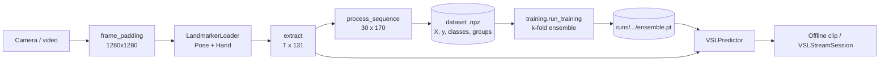

# Tài liệu VSL Translator

Tài liệu này mô tả **module hiện tại trong `src/`**: kiến trúc, luồng dữ liệu và cách sử dụng từng module.

## Mục lục

| Module | Thư mục nguồn | Vai trò | Tài liệu |
|---|---|---|---|
| MediaPipe builtin | `src/builtin/mediapipe_builtin` | Bọc MediaPipe Pose/Hand landmarker, quản lý running mode và timestamp | [mediapipe_builtin/](mediapipe_builtin/README.md) |
| Features | `src/features` | Chuẩn hoá khung hình, trích xuất 131 đặc trưng/frame, xử lý chuỗi thành `(30, 170)` | [features/](features/README.md) |
| Data | `src/data` | Ghi/đọc mẫu, trích xuất lại từ video gốc, tăng cường dữ liệu | [data/](data/README.md) |
| Model | `src/model` | Huấn luyện ensemble, hiệu chỉnh xác suất, dự đoán offline/stream | [model/](model/README.md) |
| Visualization | `src/visualization` | Vẽ landmark pose/bàn tay lên khung hình BGR | [visualization/](visualization/README.md) |

Mỗi thư mục module có:

- `README.md`: tổng quan, kiến trúc, luồng dữ liệu, điểm cần lưu ý.
- `usage.md`: ví dụ chạy và tham chiếu API.

Ngoài ra, [Đánh giá kiến trúc AI và quy trình huấn luyện](tue-17-11.md) tổng hợp điểm yếu, bằng chứng thực nghiệm và lộ trình ưu tiên (P0–P2).

## Pipeline tổng thể



### Các dạng dữ liệu chuẩn

| Tên | Shape | Ý nghĩa |
|---|---|---|
| Raw frame features | `(T, 131)` | Đặc trưng từng frame, có thể chứa `NaN` khi mất pose/tay |
| Processed sequence | `(30, 170)` | Đã nội suy, khử gai, co giãn thời gian, thêm 39 chiều chuyển động |
| Dataset | `X (N, 30, 170)`, `y (N,)` | Đầu vào huấn luyện, kèm `classes` và `groups` |
| Prediction | JSON dict | `label`, `confidence`, `accepted`, `top[{label, confidence}]` |

### Quy ước chung

- Ảnh là **BGR uint8**, luôn được đưa về **1280 x 1280** bằng `frame_padding` trước khi detect/trích xuất.
- Toạ độ landmark MediaPipe là chuẩn hoá `[0, 1]`; hệ quy chiếu thân được dựng từ hai vai, đơn vị là độ rộng vai.
- `FEATURE_VERSION = 2`, `FRAME_FEATURE_DIM = 131`, `EXPECTED_FRAMES = 30`, `SEQ_FEATURE_DIM = 170`.
- Dữ liệu huấn luyện phải dùng **cùng extractor/feature version** với checkpoint dự đoán.
- `groups` dùng để chia fold không rò rỉ: mẫu augment và bản gốc phải cùng group.

## Bắt đầu nhanh

```python
from src.model.predict import VSLPredictor
from src.features.extract import extract, process_sequence
from src.features.frame import frame_padding
from src.builtin.mediapipe_builtin import LandmarkerLoader, VisionRunningMode

# 1) Trích xuất một clip BGR đã có sẵn
loader = LandmarkerLoader(running_mode=VisionRunningMode.VIDEO)
try:
    raw = []
    for frame in frames_bgr:
        pose, hand, _ = loader.detect(frame_padding(frame))
        raw.append(extract(pose, hand))
finally:
    loader.close()

sequence = process_sequence(raw, target_len=30)  # (30, 170)

# 2) Dự đoán với checkpoint mới nhất trong runs/*/ensemble.pt
predictor = VSLPredictor()
result = predictor.predict_processed(sequence)
print(result["label"], result["confidence"])
```

## Huấn luyện nhanh

```bash
# Xuất dataset từ DataHandler (notebook thường làm bước này)
python - <<'PY'
from src.data.data_reader import DataHandler
from src.features.extract import process_sequence
handler = DataHandler(processor=process_sequence)
handler.save_npz("dataset.npz", group_by="sample")
print(handler.get_class_counts())
PY

# Huấn luyện 5-fold, lưu runs/vsl/ensemble.pt + metrics.json + ONNX
python -m src.model.training --data dataset.npz --out runs/vsl
```

> **Cảnh báo:** CLI hiện chưa đọc metadata `augmented`/`sessions` từ `.npz`, nên mặc định dùng cả mẫu augment làm validation. Notebook `notebooks/train.ipynb` truyền `validation_mask=~augmented` và là protocol đúng. Chi tiết ở [Đánh giá kiến trúc AI](tue-17-11.md).

## Phụ thuộc

- Bắt buộc: `mediapipe`, `opencv-python`, `numpy`, `torch`, `scipy`, `scikit-learn`.
- Tuỳ chọn: `onnx` cho bước xuất ONNX (nếu thiếu, `.pt` vẫn dùng được).
- Model MediaPipe đóng gói sẵn trong `src/builtin/mediapipe_builtin/models/`.
