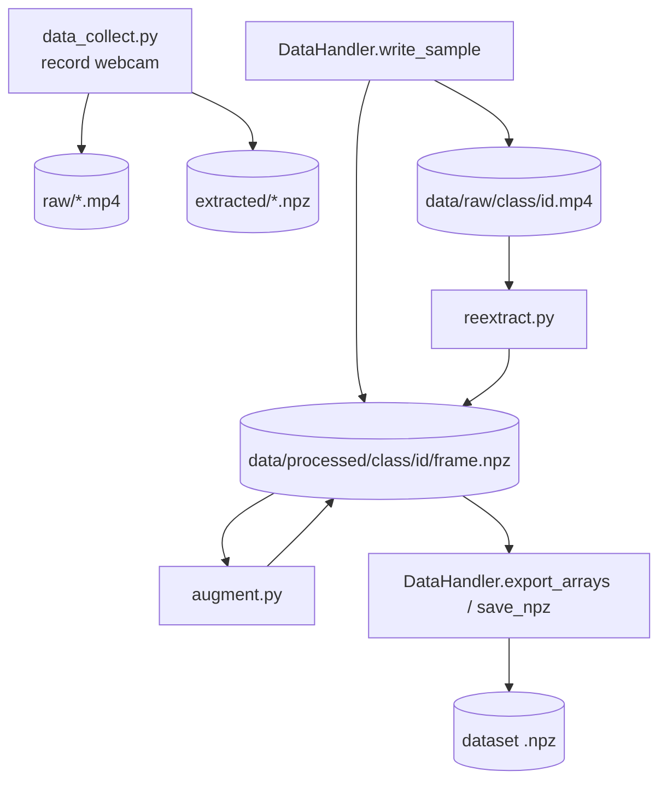

# Module `src/data`

Quản lý vòng đời dữ liệu VSL: ghi mẫu từ webcam, lưu đặc trưng theo frame, trích xuất lại từ video gốc, tăng cường dữ liệu, và xuất dataset để huấn luyện.

## Kiến trúc



### Các file

| File | Vai trò |
|---|---|
| `data_reader.py` | `DataHandler`, `SampleRef`: index, đọc/ghi mẫu, validate, export dataset |
| `data_collect.py` | CLI ghi webcam → video + chuỗi `(30, 170)` |
| `reextract.py` | Trích xuất lại đặc trưng từ `data/raw/*.mp4` khi đổi extractor |
| `augment.py` | Sinh biến thể feature-only, giữ group gốc để chia fold |
| `__init__.py` | Docstring mô tả package |

## Hai bố cục dữ liệu khác nhau

### 1. `DataHandler` — bố cục chuẩn

```text
data/
├── processed/
│   └── <class>/
│       └── <sample_id>/
│           ├── 0.npz          # key "feature", shape (131,), float32
│           ├── 1.npz
│           ├── ...
│           └── meta.json
└── raw/
    └── <class>/
        └── <sample_id>.mp4
```

- Mỗi frame là một file `.npz` chứa đúng một array `(131,) float32`, cho phép `NaN`, cấm `Inf`.
- Frame phải liên tục từ `0` đến `n-1`, tối thiểu `MIN_FRAMES = 8`.
- `meta.json` chứa `session`, `created`, `n_frames`, `fps`, `feature_dim`, có thể có `augmentation`, `origin_sample_id`, `feature_version`...
- Thư mục bắt đầu bằng `.` bị coi là tạm và bỏ qua.
- Tên lớp được chuẩn hoá **Unicode NFC** để tránh trùng lớp do macOS lưu NFD.

### 2. `data_collect` — bố cục recorder độc lập

```text
<root>/
├── raw/<class>/<id>.mp4                    # video 720x720 đã pad
└── extracted/<class>/<group>/<id>.npz      # key "X", shape (30, 170)
```

Mặc định `<root> = root_project`. Bố cục này **không** được `DataHandler` đọc trực tiếp; nó phục vụ thu thập nhanh hoặc notebook riêng.

## `DataHandler` — chi tiết

### Index và nhãn

- Quét `data/processed` mỗi khi cache bị invalid.
- Mẫu hợp lệ → `SampleRef(frame_paths, label, class_name, sample_id, session, origin_id, augmented)`.
- Chỉ lớp có ít nhất `min_samples_per_class` **mẫu gốc độc lập** mới được gán nhãn. Mẫu augment không tính vào ngưỡng này.
- `active_class_names` theo thứ tự nhãn; `class_to_idx`; `excluded_classes` ghi lớp bị loại.
- Mẫu dở dang được ghi vào `incomplete` và bỏ qua, trừ khi `strict=True` (raise `RuntimeError`).

### Đọc

- `load_raw(i)` → `(T, 131) float32`, có thể chứa `NaN`.
- `__getitem__(i)`:
  - Có `processor` → `processor(raw)`, thường là `(30, 170)`.
  - Không có `processor` → chỉ chấp nhận mẫu đúng `SEQUENCE_LENGTH = 30`, trả `(30, 131)`.
- `quality_report()` → thống kê frame, `pose_coverage`, tỉ lệ có tay trái/phải.
- `validate_dataset()` → đọc thử toàn bộ file, trả số mẫu hợp lệ.

### Ghi

`write_sample(...)`:

1. Validate số frame ≥ 8, shape `(131,)`, dtype `float32`, không `Inf`.
2. Từ chối nếu toàn bộ frame không có pose; từ chối nếu không có tay nào (trừ `require_hand=False`).
3. Ghi vào thư mục tạm `.tmp_<token>`, ghi video tạm nếu có `frames`.
4. `os.replace` thư mục/video sang tên chính thức (atomic). Nếu lỗi, dọn sạch cả bản tạm và bản đã commit dở.
5. Trả `sample_idx`; ID mới = max ID trong cả processed và raw + 1.

`remove_sample`, `get_npz`, `get_npzs`, `add_class`, `remove_class`, `refresh_dataset` thao tác trực tiếp trên đĩa.

### Nhóm để chia fold

- `sample_groups("sample")` → `"<class>/<origin_sample_id>"`; mẫu augment dùng chung group với bản gốc.
- `sample_groups("session")` → id phiên ghi.
- `export_arrays()` trả `X`, `y`, `classes`, `groups`, `sessions`, `augmented`.
- `save_npz()` ghi đúng định dạng `training.py` đọc.

## `data_collect.py`

- CLI: `python -m src.data.data_collect -c <class> -n <số mẫu> -g <group>`.
- Mở webcam, lật gương, pad 720, hiển thị preview.
- `SPACE`: bắt đầu/kết thúc ghi; `Q`/`ESC`: thoát.
- Khi kết thúc: lấy từng frame đã ghi, chạy lại detect, `extract` từng frame, `process_sequence` → `(30, 170)`, lưu video MP4 và NPZ.
- ID tiếp theo được tính trên cả `raw/<class>/*.mp4` và `extracted/<class>/<group>/*.npz`.

## `reextract.py`

- `find_raw_samples(raw_root, classes)` → danh sách video `raw/<class>/<id>.mp4`.
- `extract_video_features(video)`:
  - Đọc toàn bộ frame, pad 720, chạy `LandmarkerLoader` ở `VIDEO`.
  - Timestamp suy ra từ số frame và FPS, ép tăng nghiêm ngặt.
  - Validate: ≥ `MIN_FRAMES`, shape `(T, 131)`, float32, không `Inf`, có pose, có tay.
  - Trả `(raw_features, fps)`; đồng thời tạo `(30, 170)` để kiểm tra tính hợp lệ.
- `reextract_sample(video, raw_root, processed_root, backup_root)`:
  - Yêu cầu đường dẫn dạng `raw/<class>/<numeric id>.mp4`.
  - Trích xuất vào thư mục stage; validate từng file.
  - Chuyển mẫu cũ sang `backup_root/<class>/<id>` (không ghi đè backup đã có), rồi đổi tên stage thành mẫu mới. Nếu lỗi, khôi phục bản cũ.
  - Giữ `session` cũ, cập nhật `feature_version`, `frame_size`, `pose_coverage`, tỉ lệ tay, `source_video`, tên model, `reextracted_at`.

## `augment.py`

- `available_sources(processed_root, classes)`:
  - Chỉ trả mẫu gốc hoàn chỉnh; bỏ mẫu đã có `augmentation` trong meta; bỏ mẫu thiếu frame.
- `plan_augmentation(processed_root, classes, minimum_samples, copies_per_sample)`:
  - `minimum_samples = -1`: augment **mọi** mẫu gốc với `copies_per_sample` bản.
  - Ngược lại: tính thiếu hụt từng lớp và chia đều cho các mẫu gốc bằng heap (ưu tiên mẫu ít bản sao), tránh dồn vào một mẫu.
  - Trả `(jobs, counts)`; raise nếu lớp thiếu mẫu mà không có nguồn gốc.
- `add_feature_noise(features, rng, strength)`:
  - Nhiễu Gaussian theo từng nhóm cột, giữ nguyên `NaN` và 2 cột presence.
  - Clip `body_contact` về `[0, 1]`, `orientation` về `[-1, 1]`.
  - `strength` thuộc `(0, 3]`.
- `augment_sample(source_dir, raw_root, copies, strength, rng)`:
  - Từ chối mẫu derived, mẫu có `feature_version` cũ, hoặc mẫu không detect được pose.
  - Sinh ID số mới tránh trùng cả processed lẫn video raw.
  - Ghi vào stage `.augment_<uuid>`, thêm meta `augmentation` + `origin_sample_id`, rồi rename atomic.
  - Không bao giờ sửa/ghi vào raw.

## Quan hệ module

- Phụ thuộc `src.features.schema` (`EXPECTED_FRAMES`, `FRAME_FEATURE_DIM`), `src.features.frame`, `src.features.extract`, `src.builtin.mediapipe_builtin`.
- `data_reader` là nguồn dữ liệu cho `DataHandler.save_npz` → `src.model.training`.
- `reextract` và `augment` giữ nguyên `origin_sample_id`/`session` để `training.make_folds` không rò rỉ.

## Bất biến quan trọng

- Mọi file feature phải là `float32 (131,)`; `Inf` bị cấm, `NaN` được phép ở raw.
- `MAX/ID` của sample phải là số; thư mục tạm bắt đầu bằng `.`.
- Không augment mẫu augment (không tạo chuỗi phái sinh).
- Không đổi `feature_version` mà không trích xuất lại toàn bộ dữ liệu.
