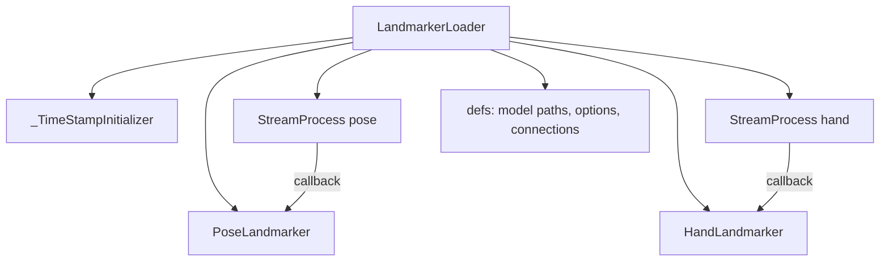

# Module `src/builtin/mediapipe_builtin`

Lớp bọc mỏng quanh **MediaPipe Tasks** cho Pose và Hand landmarker, thống nhất ba chế độ chạy (IMAGE, VIDEO, LIVE_STREAM), timestamp và vòng đời tài nguyên.

## Kiến trúc



### Các file

| File | Nội dung |
|---|---|
| `defs.py` | Đường dẫn model, alias class MediaPipe, `VisionRunningMode`, `Delegate`, danh sách connection để vẽ |
| `landmarkers_loader.py` | `LandmarkerLoader`: tạo, detect, đóng landmarker |
| `stream_process.py` | `StreamProcess`: giữ kết quả callback mới nhất cho LIVE_STREAM |
| `models/` | `pose_landmarker_full.task`, `hand_landmarker.task`, `pose_landmarker_heavy.task`, `holistic_landmarker.task` |
| `__init__.py` | Re-export `defs.*`, `StreamProcess`, `LandmarkerLoader` |

`LandmarkerLoader` hiện chỉ dùng `pose_landmarker_full.task` và `hand_landmarker.task`. Hai model còn lại có sẵn nhưng không được loader tham chiếu.

## `defs.py`

```python
from src.builtin.mediapipe_builtin.defs import (
    PoseLandmarkerPath, HandLandmarkerPath,
    PoseLandmarkerResult, HandLandmarkerResult,
    VisionRunningMode, Delegate,
    HandConnections, PoseConnections,
)
```

- Đường dẫn model tính tương đối theo `Path(__file__).parent / "models"`.
- `HandConnections` / `PoseConnections` là danh sách cặp index dùng cho vẽ.
- Alias giúp phần còn lại của project không phụ thuộc trực tiếp vào namespace dài của MediaPipe.

## `LandmarkerLoader`

### Khởi tạo

```python
LandmarkerLoader(
    delegate=Delegate.CPU,
    running_mode=VisionRunningMode.LIVE_STREAM,
    pose_model_path=PoseLandmarkerPath,
    hand_model_path=HandLandmarkerPath,
    num_hands=2,
    detection_confidence=0.5,
    presence_confidence=0.5,
    tracking_confidence=0.5,
)
```

- Tạo cả Pose và Hand landmarker; nếu tạo Hand thất bại, Pose được đóng lại trước khi raise.
- `StreamProcess` cho mỗi landmarker nhận callback khi chạy LIVE_STREAM.
- `_TimeStampInitializer` tạo timestamp ms bắt đầu từ `-1`, đảm bảo **tăng nghiêm ngặt** theo đồng hồ monotonic.

### `detect`

```python
pose_result, hand_result, timestamp_ms = loader.detect(
    frame,
    wait_for_result=False,
    timeout_s=5.0,
    timestamp_ms=None,
)
```

Luồng xử lý:

1. Gọi `frame_padding(frame)` lần nữa (an toàn nếu bên ngoài đã pad).
2. Chuyển BGR → RGB (CPU) hoặc RGBA (GPU/NPU delegate) và tạo `mp.Image`.
3. Theo `running_mode`:
   - **IMAGE**: gọi `detect()` đồng bộ, trả timestamp `None`.
   - **VIDEO**: gọi `detect_for_video()` với timestamp tăng dần; trả timestamp đã dùng.
   - **LIVE_STREAM**: gọi `detect_async()`; callback cập nhật `StreamProcess`.
     - `wait_for_result=False`: trả kết quả mới nhất hiện có (có thể `None`/cũ).
     - `wait_for_result=True`: chờ đến khi **cả pose và hand** có đúng timestamp; raise `TimeoutError` quá hạn, `RuntimeError` nếu callback bỏ qua timestamp.
4. Nếu tự truyền `timestamp_ms`, giá trị phải lớn hơn timestamp trước đó, nếu không raise `ValueError`.

Trả về bộ ba `(pose, hand, timestamp)`; với IMAGE timestamp là `None`.

### `close`

Giải phóng cả hai landmarker. Loader **không** là context manager, nên dùng `try/finally` hoặc gọi `close()` trong `finally`.

## `StreamProcess`

```python
class StreamProcess:
    latest_result = None
    latest_timestamp = None
    output_img = None
    def update(self, results, output_img, timestamp_ms): ...
    def get(self): ...
```

Chỉ là hộp chứa kết quả async. Không có đồng bộ lock — mỗi loader/session nên thuộc về một luồng hoặc một client.

## Điểm thiết kế

- **Tách khỏi logic đặc trưng**: loader chỉ trả kết quả MediaPipe; việc ghép tay, chuẩn hoá, NaN nằm ở `src/features/extract.py`.
- **Timestamp tự động** cho video/live stream, tránh lỗi MediaPipe khi timestamp không tăng.
- **Padding tập trung**: cả loader và các pipeline bên ngoài đều có thể gọi `frame_padding`; hàm này idempotent với ảnh 720.
- **Delegate**: CPU dùng RGB, delegate khác dùng RGBA để tương thích GPU.
- **Không cache model giữa các instance**: mỗi `LandmarkerLoader` tạo tài nguyên MediaPipe riêng, phù hợp cho session riêng nhưng tốn bộ nhớ nếu tạo quá nhiều.

## Quan hệ với module khác

- `src/features/extract.py` dùng `PoseLandmarkerResult` / `HandLandmarkerResult` từ `defs`.
- `src/visualization/landmarks.py` dùng `HandConnections` / `PoseConnections`.
- `src/data/data_collect.py`, `src/data/reextract.py`, `src/model/predict.py` đều tạo `LandmarkerLoader` và gọi `detect`.
