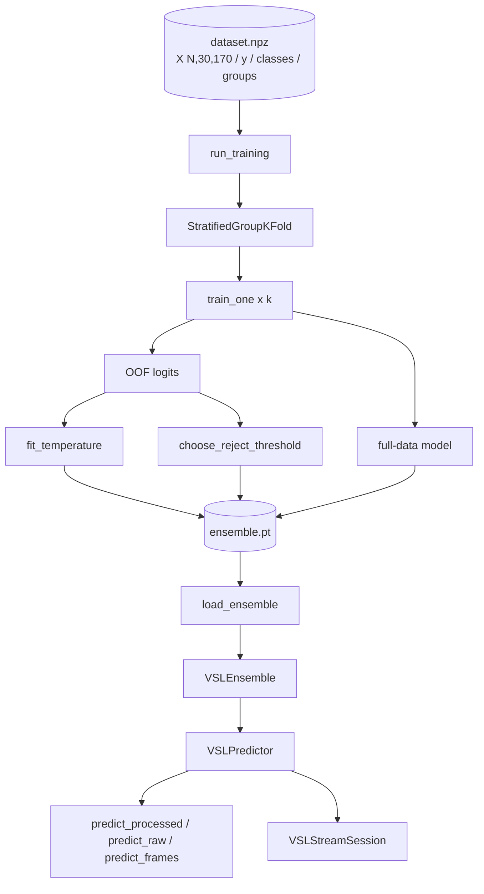

# Module `src/model`

Huấn luyện bộ phân loại chuỗi đặc trưng VSL, hiệu chỉnh xác suất, đóng gói ensemble và dự đoán từ clip hoặc luồng camera.

## Kiến trúc



### Các file

| File | Vai trò |
|---|---|
| `training.py` | Config, dữ liệu, augmentation, kiến trúc `VSLNet`, train loop, CV, hiệu chỉnh, lưu/load, ONNX, CLI |
| `predict.py` | `VSLPredictor`, `VSLStreamSession`, `StreamConfig` |
| `__init__.py` | Không có — import từ module con |

## `training.py`

### Định dạng dữ liệu

File `.npz`:

| Key | Shape | Bắt buộc | Ý nghĩa |
|---|---|---|---|
| `X` | `(N, 30, D)` float | Có | Đầu ra `process_sequence`; `D = 170` (có motion) hoặc `131` |
| `y` | `(N,)` int/str | Có | Nhãn lớp |
| `classes` | `(C,)` str | Không | Tên lớp theo thứ tự nhãn; thiếu thì suy ra từ `y` |
| `groups` | `(N,)` | Khuyến nghị | Nhóm nguồn (video/lần ghi/người) để chia fold không rò rỉ |

`load_dataset` thay `NaN/Inf` bằng 0 kèm cảnh báo. `run_training` yêu cầu ít nhất 2 lớp.

### Kiến trúc `VSLNet`

```text
(B, T, D)
   │
   ▼
GroupStem          — mã hoá riêng từng nhóm đặc trưng
   │  mỗi nhóm: Linear → LayerNorm → GELU
   │  presence (129:131) nhân presence_scale = 0.25
   │  group-dropout khi train (chịu được thiếu tay)
   ▼
MultiScaleBlock × n_blocks
   │  depthwise Conv1d kernel 3/5/9 → concat → Conv1d 1x1
   │  → BatchNorm → GELU → Dropout → residual
   ▼
BiGRU(gru_hidden)
   │
   ▼
Attention pooling + mean + max  → 6 * gru_hidden
   │
   ▼
LayerNorm → Dropout → CosineHead / Linear → logits (B, C)
```

- `GroupStem` chia cột theo `default_groups(D)`:
  - `D = 170`: `[0, 47, 111, 129, 131, 170]` — vị trí | thủ hình | hướng | hiện diện | chuyển động.
  - `D = 131`: `[0, 47, 111, 129, 131]`.
  - `D` khác: một nhóm duy nhất.
- Mỗi nhóm được chiếu tới `h = min(64, max(8, round(0.5 * width)))`; concat rồi chiếu về `d_model`.
- `CosineHead` chuẩn hoá vector và trọng số lớp, scale học được; ổn định khi nhiều lớp/ít mẫu.
- Model chạy được với mọi `T`; checkpoint lưu `in_shape = (T, D)`.

### Huấn luyện

`train_one(...)` là vòng huấn luyện một model:

- **Optimizer**: AdamW, weight decay chỉ cho tham số ≥ 2 chiều.
- **Batch size tự chọn**: `clip(N // 20, 16, 64)` nếu `batch_size = 0`.
- **LR**: warmup tuyến tính `warmup_epochs = 5`, sau đó cosine về `min_lr`; có `lr_scale` giảm một nửa khi val loss plateau (`lr_patience = 8`).
- **Class weight**: nếu tỉ lệ lớp max/min > 1.5, dùng trọng số `sqrt(N / (C * count))`.
- **AMP**: chỉ bật trên CUDA.
- **EMA**: decay 0.99; đánh giá/ checkpoint dùng EMA.
- **Early stopping**: sau `min_epochs = 30`, dừng nếu `epoch - best_epoch >= patience = 30`.
- **Chọn best**: val accuracy cao nhất; hoà thì val loss thấp hơn.
- **Log**: in mỗi `log_every = 5` epoch.

### Augmentation

`Augmenter` áp dụng trên tensor đã chuẩn hoá `(B, T, D)` với cường độ `s`:

1. **Time-warp + crop** ngẫu nhiên: mô phỏng ký nhanh/chậm, lệch đầu/cuối.
2. **Nhiễu Gaussian** biên độ `0.08 * s` + jitter biên độ theo cột.
3. **Che frame** ngẫu nhiên xác suất `0.06 * s`.
4. **Extra hand (distractor)**: với clip một tay, chèn tay đối diện từ donor khác lớp (xác suất `extra_hand_probability = 0.4`), giữ nhãn gốc; đặt các đặc trưng liên tay dùng chung về 0.

Loss bổ sung khi có extra hand:

- `extra_hand_loss = 0.5`: CE trên nhánh chèn tay.
- `hand_consistency = 0.12`: KL giữa nhánh chèn tay và nhánh gốc (teacher detached).

Mixup: xác suất `0.6 * s`, `alpha = 0.4`, tắt khi đang dùng extra hand.

### AdaptiveController

Điều hoà thích ứng bằng hai tín hiệu:

- `gap = acc(train sạch) - acc(val)` → đo overfit.
- `aug_acc` → đo model còn sức học không.

Luật (cập nhật mỗi 3 epoch, sau epoch 5):

- `aug_acc < 0.75` → giảm `s` 0.1 (điều hoà quá tay).
- `gap > 0.12` và `aug_acc > 0.85` → tăng `s` 0.1 (còn dư sức chịu thêm).
- `s ∈ [0.1, 1]`, điều khiển dropout, mixup, group-dropout, augmentation.

### Cross-validation và ensemble

`run_training(X, y, classes, groups, out_dir, ...)`:

1. Kiểm tra shape, lớp, group; yêu cầu mỗi lớp có ít nhất `k` group độc lập.
2. `StratifiedGroupKFold` (shuffle, seed) → mỗi group nằm trọn trong một fold.
3. Mỗi fold:
   - `Normalizer` fit **chỉ trên train của fold**.
   - `train_one` với early stopping.
   - Lưu OOF logits cho val.
4. Tính `temperature` bằng LBFGS trên OOF (`fit_temperature`, T ∈ `[0.2, 10]`).
5. Chọn `reject_threshold`: ngưỡng đầu tiên trong `0.20..0.95` đạt accuracy ≥ 0.95 và coverage ≥ 0.5; mặc định 0.5.
6. Huấn luyện model full-data với `epochs = median(best_epoch) * 1.15 + 1`, cường độ `s` trung bình các fold.
7. Lưu:
   - `ensemble.pt`: config, `feature_version = 2`, `groups`, `classes`, `means`, `stds`, `temperature`, `reject_threshold`, `in_shape`, `state_dicts`.
   - `classes.json`
   - `metrics.json`: CV acc, fold acc, best epochs, temperature, threshold, số model/mẫu/lớp, config.
   - `vsl_classifier.onnx` (tuỳ chọn).
8. Trả dict kèm `fold_histories`, `oof_logits`, `oof_mask`, `classes`, `y`.

`validation_mask` cho phép loại mẫu augment khỏi validation: khi đó `groups` bắt buộc và mỗi group phải có ít nhất một mẫu gốc trong validation.

### `VSLEnsemble`

- Nhận đặc trưng **thô** `(B, T, D)`.
- Với từng model `k`: `z = clip((x - mean[k]) / std[k], -8, 8)`, `NaN → 0`, `softmax(model(z) / temperature)`.
- Trung bình xác suất các model.
- Vì đã gồm chuẩn hoá + ensemble, ONNX chỉ cần input `features` thô và output `probs`.

### Suy luận

- `predict_topk(ens, X, classes, k, reject_threshold)`:
  - Trả top-k `(label, prob)`.
  - Nếu top-1 < ngưỡng, chèn `("unknown", top_prob)` lên đầu.
- `export_onnx`: opset 17, batch động, tên input `features`, output `probs`.

### CLI

```bash
python -m src.model.training --data dataset.npz --out runs/vsl
python -m src.model.training --demo --out runs/demo --folds 3 --epochs 60
```

Các cờ: `--folds`, `--folds-to-run`, `--no-full`, `--epochs`, `--head linear|cosine`, `--lr`, `--batch-size`, `--seed`, `--no-onnx`.

## `predict.py`

### `VSLPredictor`

- Khởi tạo một lần, dùng lại cho nhiều request.
- Nếu không truyền `checkpoint_path`, chọn `runs/*/ensemble.pt` mới nhất theo mtime.
- Kiểm tra checkpoint: `feature_dim` phải bằng `SEQ_FEATURE_DIM = 170`.
- Ngưỡng hiệu dụng: `max(reject_threshold, min_confidence)`, mặc định `min_confidence = 0.65`.

Ba API:

| API | Input | Xử lý |
|---|---|---|
| `predict_processed(seq)` | `(30, 170)` | Dự đoán trực tiếp |
| `predict_raw(raw)` | `(T, 131)` | `process_sequence` rồi dự đoán |
| `predict_frames(frames_bgr)` | iterable ảnh BGR | pad + detect + extract + process + dự đoán |

Kết quả:

```python
{
    "label": str | None,
    "confidence": float,
    "accepted": bool,
    "top": [{"label": str, "confidence": float}, ...],
}
```

Nếu bị từ chối, `label = None` và `top` bỏ mục `"unknown"`, nhưng `confidence` vẫn là xác suất cao nhất.

### `VSLStreamSession`

Trạng thái cho **một** luồng camera/client:

- Giữ `deque` các `(timestamp, feature)` trong cửa sổ thời gian.
- Tự sở hữu `LandmarkerLoader`.
- Có thể `reset()` mà không nạp lại model.
- `update_frame(frame, now=None)` trả trạng thái JSON:

```python
{
    "status": "idle" | "collecting" | "ready" | "predicting",
    "prediction": dict | None,
    "stable_label": str | None,
    "hand_present": bool,
    "frames": int,
    "duration": float,
}
```

- `StreamConfig`:
  - `window_seconds = 2.0`
  - `min_window_seconds = 1.5`
  - `min_frames = 8`
  - `predict_every = 3`
  - `stability_frames = 3`
  - `no_hand_timeout = 0.6`
  - `mirror_data = False`
  - `top_k = 3`
- Không có tay quá `no_hand_timeout` → xoá history và prediction.
- Dự đoán khi đủ frame + đủ thời lượng, mỗi `predict_every` frame.
- `stable_label` chỉ có khi `stability_frames` dự đoán gần nhất giống hệt nhau.
- `last_frame`, `last_pose_result`, `last_hand_result` dùng để vẽ preview cục bộ, không nằm trong JSON.
- Là context manager; `close()` giải phóng landmarker.

## Quan hệ module

- `training.py` độc lập với `src.data`: chỉ đọc `.npz`.
- `predict.py` phụ thuộc `src.features` (extract/process/frame), `src.builtin` (landmarker), và `training` (load/inference).
- `src.data.DataHandler` tạo file `.npz` đúng định dạng training.

## Bất biến và lưu ý

- `D` của dữ liệu huấn luyện phải khớp `SEQ_FEATURE_DIM` của extractor hiện tại (170).
- `groups` là bắt buộc trên thực tế: thiếu groups → mẫu cùng video/người có thể rơi vào cả train và val, làm CV lạc quan.
- Normalizer của mỗi fold chỉ fit trên train của fold đó; không dùng thống kê toàn dataset trước CV.
- `temperature` và `reject_threshold` lấy từ OOF, không lấy từ train.
- Checkpoint lưu `feature_version = 2`; đổi extractor phải huấn luyện lại.
- Model full-data dùng `Normalizer` trên toàn bộ dữ liệu (không có val nên không rò rỉ).
- Không share `VSLStreamSession` giữa các client; chỉ share `VSLPredictor`.
