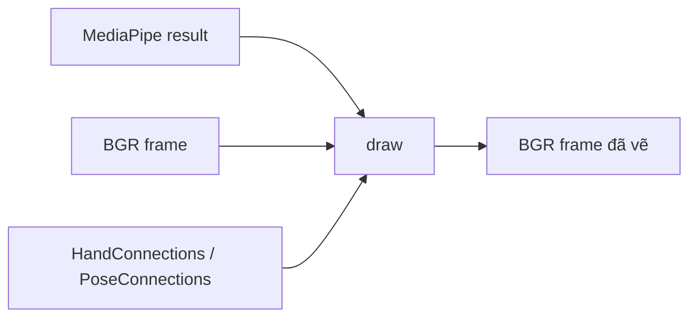

# Module `src/visualization`

Vẽ landmark pose/bàn tay lên khung hình BGR bằng OpenCV để preview và debug.

## Kiến trúc



### Các file

| File | Nội dung |
|---|---|
| `landmarks.py` | `draw(frame, results, point_color, line_color, secondary_color)` |
| `__init__.py` | Re-export `draw` |

Module rất nhỏ, không giữ trạng thái. Toàn bộ logic nằm trong `draw`.

## `draw`

```python
draw(
    frame,
    results,
    point_color=(0, 0, 0),
    line_color=(255, 255, 255),
    secondary_color=(0, 0, 0),
)
```

Luồng xử lý:

1. Nếu `results` rỗng/`None` → trả `frame` nguyên vẹn.
2. Chọn loại landmark:
   - Có `hand_landmarks` → vẽ tay, dùng `HandConnections`.
   - Ngược lại có `pose_landmarks` → vẽ pose, dùng `PoseConnections`.
   - Không có cả hai → trả `frame`.
3. Lấy chiều cao/rộng frame để đổi toạ độ chuẩn hoá sang pixel: `(x * W, y * H)`.
4. Với mỗi bàn tay (nếu là hand result):
   - Nếu `handedness` có nhãn `"Left"`, dùng `secondary_color` cho cả điểm và đường.
   - Nếu không, dùng `point_color`/`line_color`.
5. Vẽ connection bằng `cv2.line` độ dày 2, sau đó vẽ điểm bằng `cv2.circle` bán kính 4.

Hàm **sửa trực tiếp** `frame` (in-place) và trả lại chính object đó; không copy.

## Điểm thiết kế

- Không phụ thuộc vào `mediapipe` trực tiếp — chỉ dùng connection list từ `src.builtin.mediapipe_builtin.defs`.
- Không quan tâm frame đã pad hay chưa; chỉ cần frame BGR có shape `(H, W, 3)`.
- Màu mặc định là BGR, không phải RGB.
- Không kiểm tra biên: landmark ngoài `[0, 1]` có thể vẽ ra ngoài khung (OpenCV tự cắt).
- Không hỗ trợ kết quả holistic (chỉ hand hoặc pose).
- Không có hàm `draw_visualize_features2frame`; đây là API đã bị bỏ.

## Quan hệ module

- Dùng `HandConnections`, `PoseConnections` từ `src.builtin.mediapipe_builtin.defs`.
- Được dùng trong demo/realtime để hiển thị kết quả detect; không tham gia pipeline đặc trưng.
