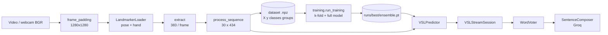

# Kiến trúc

## Các tầng

| Tầng | Thư mục | Vai trò | Ghi chú |
|---|---|---|---|
| Landmark | `src/builtin/mediapipe_builtin` | bọc MediaPipe Pose/Hand | [[Module-mediapipe-builtin]] |
| Đặc trưng | `src/features` | pad khung, trích đặc trưng, giả lập bối cảnh | [[Module-features]] |
| Dữ liệu | `src/data` | ghi/đọc mẫu, trích lại, tăng cường | [[Module-data]] |
| Mô hình | `src/model` | huấn luyện, dự đoán, bộ nhớ cá nhân | [[Module-model]] |
| Ứng dụng | `src/app` | realtime webcam, HTTP API, bỏ phiếu, ghép câu | [[Module-app]] |
| Web | `external/vsl-web` | Next.js, MediaPipe chạy trên trình duyệt | [[Module-web]] |

## Quyết định thiết kế đáng nhớ

- **Hợp đồng đặc trưng** nằm ở `extract.py`; mọi chỉ số cột lấy từ `FEATURE_SLICES`, không hard-code ([[Feature-Contract]]).
- **Chống rò rỉ**: mẫu tăng cường dùng chung nhóm với mẫu gốc, validation chỉ dùng mẫu gốc ([[Data-Layout]]).
- **Mỗi client một `VSLStreamSession`** (giữ landmarker và lịch sử frame riêng), không chia sẻ.
- **Web chỉ gửi landmark**, server chạy `extract` nên đặc trưng giống hệt pipeline train ([[Workflow-Web-API]]).
- **Từ chối dự đoán** (`ambiguous` / `low_confidence`) thay vì luôn trả nhãn cao nhất.
