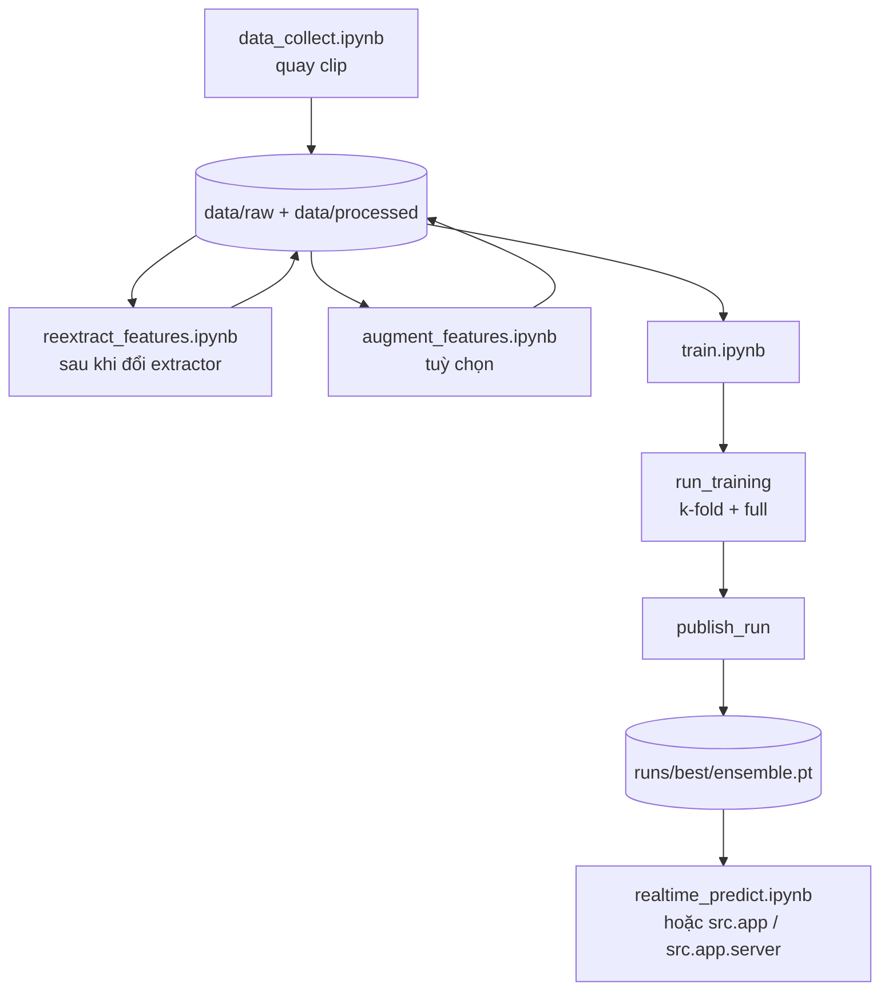

# Từ video đến mô hình

1. **Thu**: `data_collect.ipynb` hoặc CLI `python -m src.data.data_collect -c <lớp>`; `alphabet_data_collector.ipynb` cho chữ cái. `MIRROR_DATA` phải giống lúc chạy thực tế.
2. **Trích lại** (`reextract_features.ipynb`, `src/data/reextract.py`): dựng đặc trưng và `landmarks.npz` từ video gốc. Bắt buộc sau khi đổi extractor ([[Feature-Contract]]).
3. **Tăng cường** (`augment_features.ipynb`): xem [[Module-data]].
4. **Huấn luyện** (`train.ipynb`): `run_training` train vào thư mục tạm `<timestamp>`, `checkpoints.publish_run` đổi thành `runs/best` ([[Module-model]]). `vsl_model_finetuner.ipynb` tinh chỉnh ensemble đã có với dữ liệu mới và cũng dùng `publish_run`.
5. **Đánh giá**: `metrics.json` (`cv_acc_mean`, `confusion_pairs`, `closest_rivals`, `reject_threshold`, `temperature`); CV theo mẫu gốc đánh giá cao hơn thực tế khi một lớp chỉ có một buổi quay ([[Data-Layout]], [[Experiment-Tools]]).
6. **Dùng**: [[Workflow-Realtime]] hoặc [[Workflow-Web-API]].
