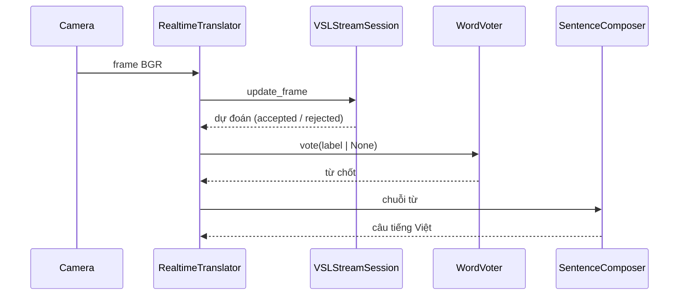

# Dịch realtime bằng webcam

Lệnh: `.venv/bin/python -m src.app [--checkpoint runs/.../ensemble.pt] [--no-llm] [--fast]` ([[Module-app]]).

- Dự đoán chỉ bắt đầu khi cửa sổ đủ `min_window_seconds`; phiếu bị từ chối làm đứt chuỗi đếm.
- `--fast`: sàng lọc bằng model toàn bộ dữ liệu, chốt sớm khi rất chắc và xác nhận bằng ensemble.
- Cần `GROQ_API_KEY` (môi trường hoặc `.env`) để ghép câu; thiếu thì dùng `--no-llm`/ghép thô.
- Notebook tương đương: `realtime_predict.ipynb`.
