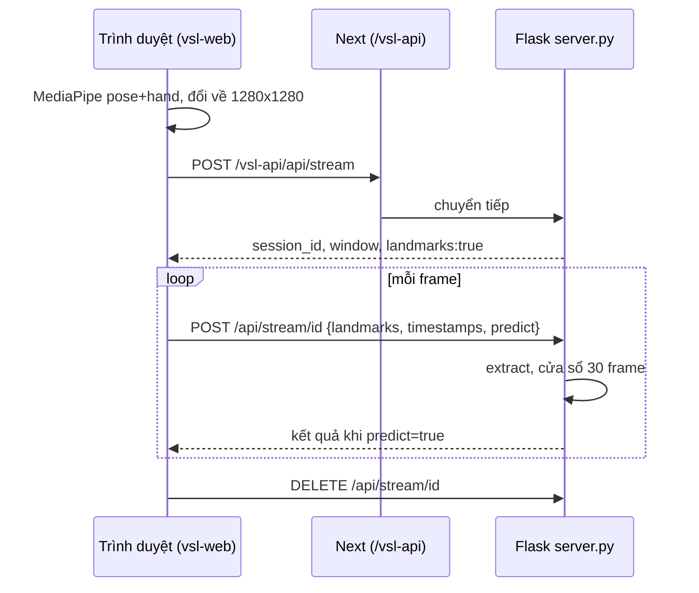

# Web + HTTP API

Chạy: `.venv/bin/python -m src.app.server --port 8000` rồi web ([[Module-web]]). Mặc định server chạy trên CPU 1 luồng.

## Endpoint (`src/app/server.py`)

| Route | Tác dụng |
|---|---|
| `GET /` | trang thử `static/test_client.html` |
| `GET /api/health` | trạng thái, checkpoint, danh sách lớp, `expected_frames`, `feature_dim`, `stream` |
| `POST /api/predict` | một clip 30 frame: `frames` (ảnh base64), hoặc `landmarks`, hoặc `features` |
| `POST /api/stream` | mở phiên; 503 khi quá `--max-streams` |
| `POST /api/stream/<id>` | thêm frame mới (JSON hoặc multipart), `predict`, `reset`, `window`, `min_frames`, `fill`, `fps` |
| `DELETE /api/stream/<id>` | đóng phiên |
| `POST /api/stream/<id>/memory` | nạp mẫu cá nhân vào phiên ([[Module-model]]) |
| `POST /api/memory/sample` | trích feature thô từ landmark của một lần ký |

- Phản hồi dự đoán thêm `frames`, `hand_frames` (0 nghĩa là người dùng đang nghỉ tay), `elapsed_ms`; lỗi đầu vào trả 400 `{"error": ...}`.
- Cửa sổ tính theo thời gian (timestamp của client, thiếu thì suy từ `fps`): `window=30` ở 15 fps là 2 giây gần nhất.
- Cờ CLI: `--checkpoint`, `--host`, `--port`, `--frames`, `--mirror-data`, `--min-confidence`, `--min-gap`, `--max-streams`, `--device`, `--torch-threads`.
